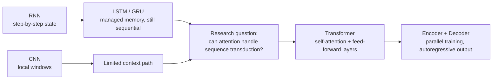
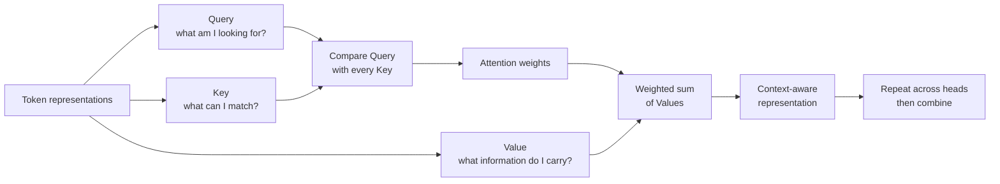

# Attention Is All You Need — Research Journey

**What if the biggest shift in sequence modeling began by changing how a model looks at a sentence?**

An educational review of the 2017 Transformer paper, prepared for the **Research Journey** course at **HIT — Holon Institute of Technology**.

  <a href="presentation/attention-is-all-you-need-public.pdf"><b>📄 Full Presentation</b></a> ·
  <a href="presentation/attention-is-all-you-need-highlights.pdf"><b>✨ Highlights</b></a> ·
  <a href="docs/key-takeaways.md"><b>🧭 Key Takeaways</b></a> ·
  <a href="https://arxiv.org/abs/1706.03762"><b>🔗 Original Paper</b></a>

---

## 🧭 Why This Paper Matters

Before the Transformer, sequence models usually carried context step by step or through local windows. *Attention Is All You Need* asked a sharper question:

> Can a sequence-to-sequence model connect the relevant words directly, while making more of the computation parallel?

The paper's answer introduced the Transformer: an architecture built around attention rather than recurrence or convolution. Our presentation turns that shift into a beginner-friendly research journey, from the limits of earlier models to the ideas behind the encoder, decoder, and attention mechanism.

> This repository documents a student presentation and review of published research. It does not claim authorship of the Transformer paper, original experiments, or new research findings.

## 🗺️ From Sequential Processing to Attention

The presentation follows this conceptual path:

| Earlier approach | Limitation highlighted in the review | What attention changes |
| --- | --- | --- |
| **RNN** | Processes tokens sequentially and carries context through recurrent state | Replaces the recurrent path with direct attention links |
| **LSTM / GRU** | Adds memory controls, but keeps sequential processing | Avoids relying on a sequential memory path |
| **CNN** | Uses local windows, so distant relationships require longer paths | Makes every position available to each attention calculation |
| **Transformer** | — | Combines self-attention, multi-head attention, and parallelizable training |

## 🔍 The Core Idea: Attention

For each attention head, token representations are projected into three learned views:

- **Query** — what this token is looking for
- **Key** — what each token offers for matching
- **Value** — the information carried into the output

Self-attention compares each Query with the Keys across the sequence, then combines the corresponding Values. Multi-head attention repeats that calculation through several learned projections and combines the results.

## 🧱 Inside the Transformer

The architecture then places that mechanism into two cooperating stacks:

- **Encoder:** transforms the input representations through repeated self-attention and feed-forward sublayers.
- **Decoder:** generates output tokens autoregressively with masked self-attention and encoder–decoder attention.
- **Add & Norm:** carries information between sublayers while stabilizing the stack.
- **Training and generation:** positions can be processed together during training, while decoding still predicts the next token without looking ahead.

## 📊 What We Explored

| Research lens | Questions followed in the presentation |
| --- | --- |
| **Motivation** | Why did sequential processing and local windows make long-range sequence modeling harder? |
| **Mechanism** | How do Query, Key, Value, self-attention, multi-head attention, masking, and encoder–decoder attention work together? |
| **Evidence** | How did the paper frame translation evaluation, training cost, BLEU scores, computational complexity, parallelization, and path length? |

This is a guided reading of the paper as presented by the student team, not a report of experiments performed by this repository's authors.

## 📚 Presentation Materials

| Resource | Purpose |
| --- | --- |
| [📄 Public presentation](presentation/attention-is-all-you-need-public.pdf) | The complete 40-page educational presentation |
| [✨ LinkedIn highlights](presentation/attention-is-all-you-need-highlights.pdf) | Nine selected slides in the original order and appearance |
| [🧭 Key takeaways](docs/key-takeaways.md) | A concise written summary of the concepts explored |

The presentation was deliberately designed to make complex AI concepts accessible to beginners while preserving the paper's central ideas.

## 📝 Personal Reflection

The shared presentation belongs to all three contributors. Separately, **Shlomi Hazan** wrote an individual reflection about his learning experience and growing interest in AI research.

- [Read the reflection in Markdown](docs/personal-reflection-en.md)
- [View the reflection as a PDF](docs/personal-reflection-en.pdf)

## 🎓 Academic Context & Contributors

**Course:** Research Journey  
**Institution:** HIT — Holon Institute of Technology

The presentation was prepared jointly by:

- **Shlomi Hazan**
- **Almog Schwartzberg**
- **Amit Herner**

## 📖 Research Paper

[Attention Is All You Need — Vaswani et al. (2017)](https://arxiv.org/abs/1706.03762)

This repository is an educational review of that published research. It presents the paper's concepts and reported evaluation as a student learning artifact, not as original Transformer research.

> Sometimes a breakthrough becomes clearer when we start with the question that made it necessary.
